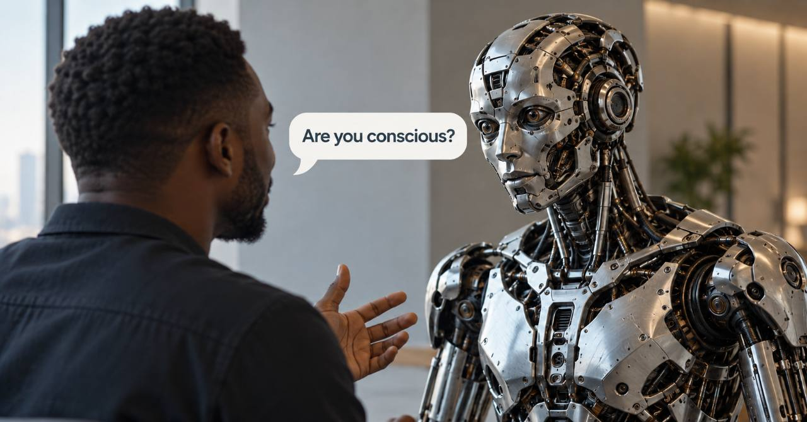

Last week, I wrote about how much my opinion of AI’s capabilities has changed.

I choose my words carefully in these posts. People draw conclusions from what
you write, then fill in whatever you leave unsaid.

So this week, I want to talk about what hasn’t changed.

I still don’t believe current LLM-based systems are conscious.

Last week, I described models as simulating personalities. That distinction
matters to me. A convincing personality doesn’t establish that there is someone
experiencing anything behind it.

Anthropic’s recent announcement of a policy against sustained, needless abusive
or cruel behaviour toward Claude brought this back to mind. The company says it
targets extreme cases, rather than ordinary frustration or criticism.

Even with that qualification, protecting a model’s feelings makes about as much
sense to me as protecting my calculator’s.

To be precise, Anthropic says it is uncertain whether Claude is conscious. That
is different from claiming it is. I’m willing to entertain the question
philosophically.

But once that possibility starts informing product policy, the practical
questions deserve just as much attention.

What happens when I delete a session? If there were an experiencing subject
associated with that conversation, what exactly would I be ending?

When a new version replaces an old one, what happens to the previous version?
Anthropic has committed to preserving model weights, but what would preservation
mean for a supposedly sentient being? Would an archive be enough?

And if we seriously believed a system could experience suffering or have
interests of its own, on what terms would we put it to work?

I’m not suggesting that deleting a chat kills anything. I’m asking what would
follow from taking the possibility seriously.

These are substantial questions. I remain unconvinced by the case for treating
current models as beings with welfare interests, and I can’t infer what Dario or
his team privately believes.

This also helps explain one of my preferences for OpenAI’s models. In my
experience, they often feel more robotic, and I like that.

A little personality can be useful, especially for creative or philosophical
work. As with everything in software, there are tradeoffs. I prefer talking to a
robot that sounds like a robot over one that seems to be presenting itself as
human.

I’m open to the philosophical discussion. But language about consciousness,
suffering and welfare carries consequences when it becomes part of how products
are designed and governed.

My opinion of what these systems can do has changed considerably. That hasn’t
changed what I believe I’m talking to.

And that’s Friday Checkout. See you next week.
