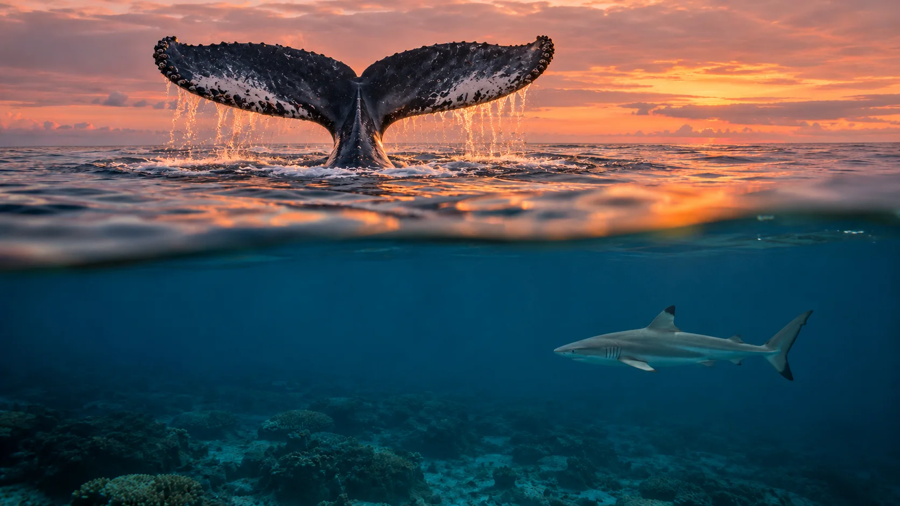

Sharks and whales live in the same water. They move through it differently. They feed differently. They breathe differently.

The ancestors of whales lived on land. Over millions of years, their descendants adapted to life in the water. Today, the ocean is their natural habitat.

Even after all that time, whales never developed gills. They still breathe air, just like the rest of us mammals. They hold their breath underwater and come up to breathe through their blowholes. They give birth and nurse their young. They call to one another.

Whatever first took their ancestors into the water may be long gone. The land is still there, but whales have long since lost the ability to live on it.

They've made the ocean their home. From the outside, it might look like they're just managing.

This is about immigration, naturalisation, and going back.

Now go back and read it again.

If you're a mammal and you suddenly find yourself in the ocean, don't try to become a fish.

Take the best of the world you came from and the best of the one you live in now. Become something the ocean has never seen before.
